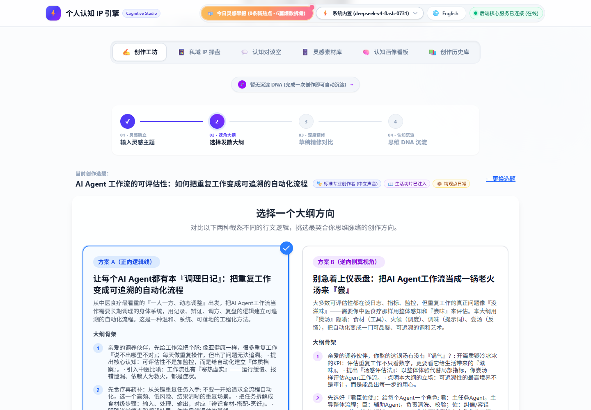
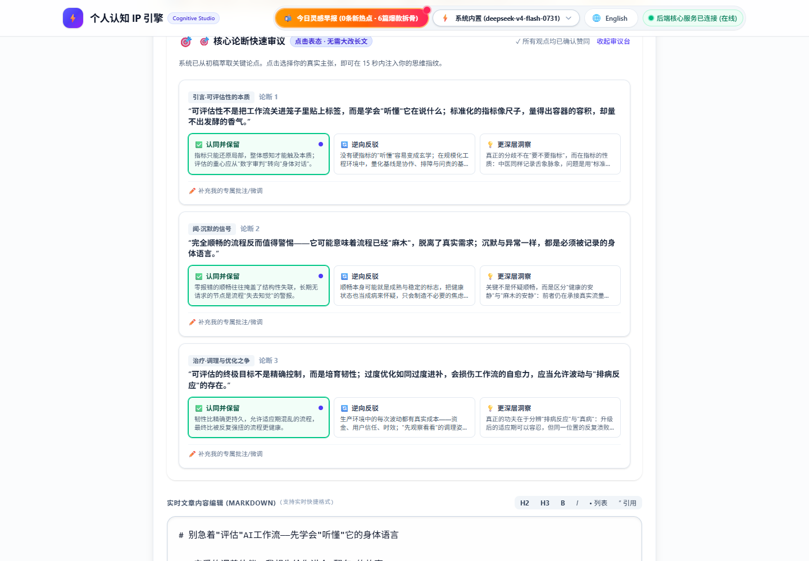

# 个人认知 IP 引擎（脱敏展示版）

> 中文（默认） | [English](README.en.md)

一个把用户「写作 DNA」变成可重复 AI 内容流水线的个人内容生产引擎：

**选题 → 两版发散大纲（A/B）→ 完整初稿 → 人工编辑 → 基于差异的思维 DNA 提取 → 画像演化 → 多平台排版**

本仓库是**脱敏展示副本**。删除了什么、还有什么待确认，见 `PROVENANCE.md`。

> 状态诚实声明：这是一个本地开发项目，**未部署上线**、**无真实用户**、**没有**任何实测性能或业务指标。本仓库中只有 `docs/evaluation.md` 记录的测试数字是真实的，其余均标为「未测」。

## 实际功能（代码核实）

| 能力 | 状态 | 代码位置 |
| --- | --- | --- |
| 发散大纲生成（A/B） | 已实现 | `backend/app/engine/agents/outline_agent.py` |
| 带画像 / DNA / 记忆上下文的初稿生成 | 已实现 | `backend/app/engine/agents/draft_agent.py` |
| 基于差异的思维 DNA 提取 | 已实现 | `backend/app/engine/agents/diff_agent.py` |
| 零差异基线门控（无改动则跳过 LLM 调用） | 已实现 | `diff_agent.py` |
| 代码级「AI 腔」词法过滤 | 已实现 | `backend/app/utils/lexical_filter.py` |
| 面向 Agent 读路径的驱动级只读数据库引擎 | 已实现（范围有限） | `backend/app/core/db.py` |
| 情节记忆 + 蓝图 + 观点冲突记忆 | 已实现 | `backend/app/services/memory_*.py` |
| 混合检索（词法 + 向量余弦）用于素材 / DNA | 已实现 | `backend/app/services/memory_retrieval.py`、`memory_dna_retrieval.py` |
| 爆款风格指纹分析（规则 + LLM） | 已实现 | `backend/app/api/viral_analysis.py` |
| 基于规则的评分基准（43 条人工标注样本） | 已实现 | `backend/app/engine/rubrics/` |
| 带受限令牌沙盒的 Skill 引擎 | 已实现（隔离有限） | `backend/app/core/skill_engine/` |
| 微信 / 小红书 / X / 短视频排版 | **有缺陷**（NameError） | `skills/content-multi-distributor/scripts/_formatters*.py` |
| 观点冲突检测 | **有缺陷**（NameError） | `backend/app/services/memory_conflicts.py` |
| 微信聊天记录导入 | 未找到实现 | — |
| 多平台自动发布（非仅排版） | 未实现 | — |
| LoRA / QLoRA 微调训练 | 未实现 | — |

## 架构一览

```
Vue 3 前端
   |
FastAPI（私有路由需鉴权；公开路由为白名单）
   |
CognitiveEngine（无头外观层；固定编排，不是自主规划 Agent）
   |-- OutlineAgent  -> ModelGateway（角色 -> 模型）
   |-- DraftAgent    -> ModelGateway + 只读上下文装配
   |-- DiffAgent     -> ModelGateway + 可写 DNA 回写
   |-- 爆款语义分析流水线
   |
Services（记忆、认知画像、风格选择、爬虫、凭据）
Core（db + 只读引擎、auth、net_guard SSRF、crypto、skill engine）
Skills（SKILL.md + 由沙盒执行器运行的 python 脚本）
```

详细流程见 [docs/architecture.md](docs/architecture.md)。

## 技术栈

- 后端：Python 3.13、FastAPI、SQLModel / SQLAlchemy、Pydantic v2、pydantic-settings、`openai`（AsyncOpenAI，OpenAI 兼容）、`cryptography`、`playwright`、`trafilatura`、`qrcode`、`uvicorn`。
- 前端：Vue 3 + TypeScript + Vite、Tailwind CSS 4、jszip。
- 数据库：默认 SQLite（支持 PostgreSQL；两者均在驱动层强制只读会话）。
- 测试：pytest + pytest-asyncio（`backend/tests` 下 55 个测试文件，另有 18 个 `backend/test_*.py`）。
- 仅 Windows：Skill 沙盒通过 ctypes 使用真实的 Windows 受限令牌。

## 运行条件

- Python >= 3.13，Node >= 20。
- 需要 OpenAI 兼容 API Key（`OPENAI_API_KEY`）。**没有你自己的 Key，展示副本无法调用真实模型。**
- 沙盒受限令牌需要 Windows 10/11；其他平台执行器按设计「失败即关闭」。

## 快速开始

```powershell
cd backend
python -m venv .venv
.\.venv\Scripts\pip install -e .
Copy-Item ..\.env.example .env        # 然后填入 OPENAI_API_KEY
.\.venv\Scripts\python -m uvicorn app.main:app --reload --port 8000
```

```powershell
cd frontend
npm install
npm run dev      # http://localhost:5173
```

- Swagger：http://localhost:8000/docs
- 健康检查：http://localhost:8000/api/health（公开端点）

运行测试（无需凭据）：

```powershell
cd backend
.\.venv\Scripts\python -m pytest -q
```

## 展示入口

| 想看什么 | 文件 |
| --- | --- |
| 固定多阶段流水线 | `backend/app/engine/cognitive_engine.py` |
| 三个核心 Agent | `backend/app/engine/agents/*.py` |
| 模型网关（角色 -> 模型、结构化输出、回退） | `backend/app/engine/model_gateway.py` |
| 只读数据库引擎 | `backend/app/core/db.py` |
| 词法过滤器 | `backend/app/utils/lexical_filter.py` |
| 沙盒模式透明度 | `backend/app/core/skill_engine/windows_sandbox.py` |
| 受限令牌 ctypes 绑定 | `backend/app/core/skill_engine/restricted_token.py` |
| 治理规则 | `AGENTS.md`、`scripts/check_code_style.py`、`scripts/check_doc_coverage.py` |

## 文档索引

- [架构说明](docs/architecture.md)
- [演示说明](docs/demo.md)
- [评测与测试证据](docs/evaluation.md)
- [简历材料与个人贡献边界](docs/resume-notes.md)
- [功能状态清单（代码核实）](docs/feature-status.md)
- [来源与公开权限说明](PROVENANCE.md)
- 英文副本：[README.en.md](README.en.md)

## 真实运行截图

三张截图来自 2026-10-15 的一次**真实模型**本地运行，输入为合成数据，独立演示数据库。

| 截图 | 页面 | 体现的能力 |
| --- | --- | --- |
|  | 工作台选题输入 | 选题作为流水线入口，发起真实 `POST /api/outlines/generate` |
|  | A/B 发散大纲 | `OutlineAgent` 真实模型输出两版结构化大纲，并支持选择 |
|  | 初稿编辑器 | `DraftAgent` 真实模型生成 1301 字初稿，含归档 / 排版 / DNA / 观点动作 |

模型：`deepseek-v4-flash-0731`（OpenAI 兼容端点）。完整复现步骤与结果见 [docs/demo.md](docs/demo.md)。

## 本人贡献边界（已与本人确认）

- 个人项目 / solo project。
- 本人负责：**需求分析、系统与架构设计、Code Review、整体功能测试、项目功能管理与项目规则管理**。
- 实现代码主要为 **AI 辅助产出**，不应表述为本人逐行编写全部模块。
- 详见 [docs/resume-notes.md](docs/resume-notes.md)。

## 已知限制

1. 这是**固定编排工作流**，不是自主规划 Agent：没有 planner、router、reflection、LLM tool calling，也没有 Agent 间协商。
2. 沙盒隔离**部分实现**：真实受限令牌（`CreateRestrictedToken` + `CreateProcessAsUserW`），但**没有** AppContainer、文件系统 ACL 隔离、网络隔离，不启动 `WindowsSandbox.exe`，不完整执行 `SKILL.md` 的 `permissions` 策略；失败时按设计关闭而非静默降级。
3. 数据库只读隔离**仅覆盖 Outline / Draft 的输入上下文装配**；初稿归档与 Diff/DNA/画像演化为有意可写。
4. 多平台排版与观点冲突检测存在已知一行导入缺陷（`NameError`）；测试全量为 `992 passed / 18 failed / 3 skipped`，详见 [docs/evaluation.md](docs/evaluation.md)。
5. 多平台自动发布、微信聊天记录导入、LoRA/QLoRA 微调**均未实现**。
6. 检索召回率、答案 / 初稿质量、延迟、成本、用户量、业务收益**全部未测**。

## 公开范围与脱敏

已排除：`.git`、`.env`、真实数据库（`*.db` / `*.sqlite*`）、日志、缓存、`.venv`、`node_modules`、构建产物、`backend/data/`。
`.env.example` 只保留变量名与空值。演示数据均为合成数据，标注在 `docs/demo.md` 中。
来源与仍待确认的公开权限项见 `PROVENANCE.md`。**本仓库没有 LICENSE，公开前需自行选择并添加。**
